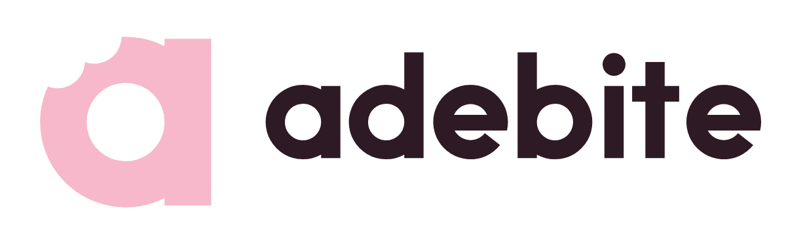

# adebite — brand

Private calorie and gym tracker for you and a few friends. Pastel pink and
white, with a deep plum for text.



## Name

- Always **adebite**, all lowercase, one word — also at the start of a
  sentence ("adebite works best on your home screen").
- Never "Adebite", "AdeBite", "ADEBITE" or "a-de-bite".
- The old name, Fuel & Lift, survives only in code identifiers (Go module,
  repo folder, database names). Don't use it in anything a person reads.

## The logo

**Idea:** a chunky lowercase "a" with a bite taken out of it. It stands for
every meal you log, and plays on the "bite" in the name. The bite has two
scallops (a real bite), which keeps it clear of a single round notch.

| Part | What it is |
|---|---|
| Symbol | The bitten "a". Use alone for the app icon, favicon, avatars. |
| Wordmark | "adebite" in custom geometric letters (stroke 32, x-height 120 on a 256 grid). It is drawn, not typed: never retype it in a font. |
| Lockup | Symbol + wordmark, side by side. The default logo. |

### Which version where

| Background | Use | File |
|---|---|---|
| White or blush (`#FFFFFF`, `#FBEFF3`) | Pink symbol, plum wordmark | `adebite-lockup-color.svg` |
| Pastel pink (`#F6B8CA`) | White symbol, plum wordmark | `adebite-lockup-on-pink.svg` |
| Plum (`#2E1A24`) or photos | Pink symbol, white wordmark, or all white | `adebite-lockup-white.svg` (all white) |
| One colour only (print, stamp, embroidery) | All plum or all black | `adebite-lockup-plum.svg`, `adebite-lockup-black.svg` |
| App icon | White symbol on a pink tile | `adebite-icon.svg` (rounded), `adebite-icon-square.svg` (full bleed) |

### Clear space and size

- **Clear space:** keep at least the width of the "a"'s stem (about a quarter
  of the symbol's height) empty on every side.
- **Minimum size:** symbol 16 px (favicon); lockup 20 px tall on screen,
  15 mm wide in print. Below that, use the symbol alone.
- **App icons:** the symbol takes 68% of the tile; 56% for Android maskable
  icons, so it stays inside the safe zone.

### Don't

- Retype the wordmark, change its letters or space them out.
- Recolour the logo outside the palette, add gradients, shadows or outlines.
- Put the pink symbol on pink, or the pink logo on photos with no contrast.
- Move the bite, add more bites, or "fix" the bite into a single round one.
- Stretch, rotate or crop the logo.
- Use the pink logo for small text-sized uses on white: below 32 px, use the
  plum version or the app icon.

## Colour

Two brand colours, one text colour. Pink is the brand; plum is there so text
stays readable.

| Name | HEX | RGB | Use |
|---|---|---|---|
| **Pink** | `#F6B8CA` | 246 184 202 | Brand colour: logo, accent buttons, highlights, Login/Join screens |
| **White** | `#FFFFFF` | 255 255 255 | Cards, sheets, the symbol on pink |
| **Plum** | `#2E1A24` | 46 26 36 | Text, primary buttons, dark screens (Paywall, Review) |

App tokens (`web/app/globals.css`):

| Token | HEX | Role |
|---|---|---|
| `ground` | `#FBEFF3` | Screen background (blush white) |
| `surface` / `sheet` / `field` | `#FFFFFF` / `#FFF8FA` / `#FDF3F6` | Cards, sheets, inputs |
| `chip` | `#F8E2EA` | Neutral chips |
| `ink` / `ink-soft` / `muted` | `#2E1A24` / `#4A3340` / `#765A67` | Text, strongest to quietest |
| `line` / `line-soft` / `dash` | `#ECD3DD` / `#F7E8EE` / `#C9A9B6` | Borders and dividers |
| `pink` / `pink-soft` | `#F6B8CA` / `#FBDCE6` | Brand accent |
| `protein` | `#A82F61` | Rose: protein macro, accent text and links on light screens |
| `carbs` / `fat` | `#EE8FB0` / `#F2B48C` | Macro charts |
| `night` … `night-soft` | `#2E1A24` … `#EBDBE2` | Dark screens |
| `danger` | `#B0261C` | Errors and destructive actions |
| `warn` / `warn-line` / `warn-bg` | `#8A4B00` / `#D39A52` / `#FBEADB` | Warnings |

### Contrast rules (WCAG)

| Pair | Ratio | OK for |
|---|---|---|
| Plum on white | 16.3 : 1 | All text |
| Plum on pink | 9.8 : 1 | All text |
| Muted on blush | 5.5 : 1 | Body text |
| Rose (`protein`) on white | 6.5 : 1 | Body text, links |
| Pink on plum | 9.8 : 1 | All text |
| White on pink | 1.7 : 1 | **Logo and big shapes only, never text** |
| Pink on white | 1.7 : 1 | **Logo and big shapes only, never text** |

The Login and Join screens are pink: `.theme-blush` re-points the `night-*`
tokens to plum-on-pink values, so those screens keep the same markup.

## Typography

- **Interface:** Schibsted Grotesk (variable, 400–900, SIL OFL), self-hosted
  in `web/app/fonts` so the installed PWA works offline. Headlines extrabold
  with tight tracking (−0.02 to −0.03 em); body regular at 15–16 px.
- **Wordmark:** custom drawn geometric letters (see above). Don't set
  "adebite" in Schibsted Grotesk as a logo; in running text it is fine.

## Sign in with Google

The button follows Google's branding guidelines
(developers.google.com/identity/branding-guidelines):

- The official four-colour "G", unmodified, at 20 px.
- Light theme: white fill, `#747775` 1 px border, `#1F1F1F` label.
- Approved copy only: "Continue with Google" (or "Sign in with Google").
- Our rounded corners are allowed. The label uses Schibsted Grotesk rather
  than Roboto, so it works offline; switch to Roboto Medium if Google's review
  asks for it.

## Voice

Short, friendly, plain. Talk about food and training like a friend would:
"Eat, lift, and see it add up." No guilt, no diet-culture language, no
exclamation marks on every line.

## Files

```
docs/brand/
  BRAND.md                this file
  logo/                   SVG masters (true curves, no fonts, no effects)
    adebite-symbol-{pink,plum,white,black}.svg
    adebite-wordmark-{plum,pink,white,black}.svg
    adebite-lockup-{color,on-pink,plum,white,black,pink}.svg
    adebite-icon.svg, adebite-icon-square.svg, adebite-icon-maskable.svg
    png/                  PNG exports and favicon.ico
  concepts/               the original three concepts, for the record
  source/                 Python that draws the masters (needs shapely)
```

In the web app:

- `web/components/brand/logo.tsx` — `<Logo />` lockup (`onPink` for pink screens).
- `web/scripts/make-icons.mjs` — PWA icons; `npm run icons` rebuilds `public/icons`.
- `web/app/favicon.ico` — 16/32/48 px favicon.

If the mark changes, run `python3 docs/brand/source/final.py docs/brand/logo`,
then paste the printed paths into `logo.tsx` and `make-icons.mjs`.

Trademark: no clearance search has been done. Run one before you spend money
on print or register the name.
